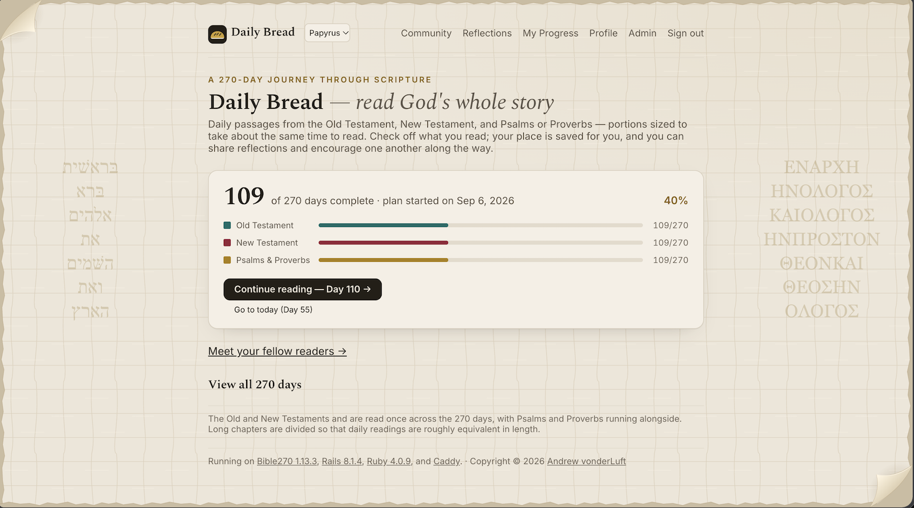
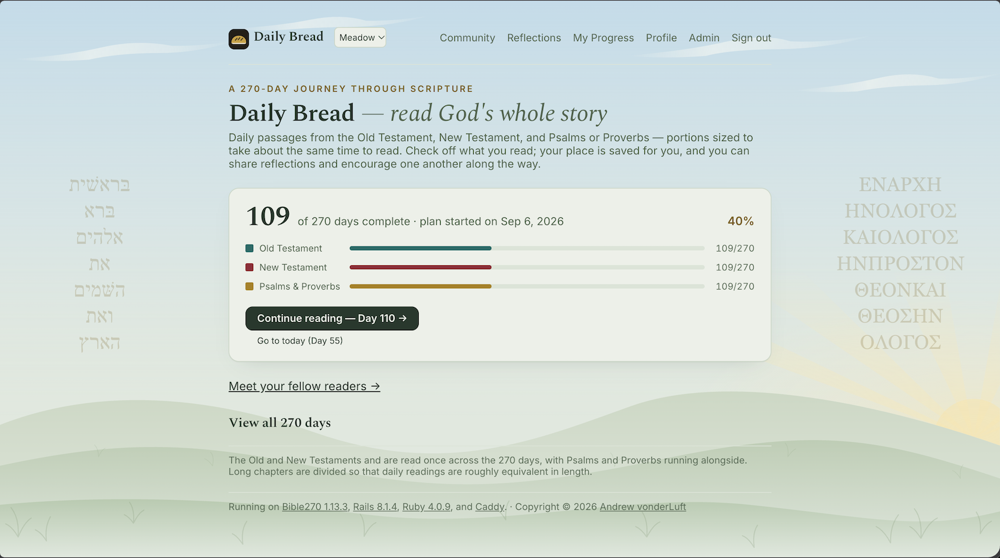
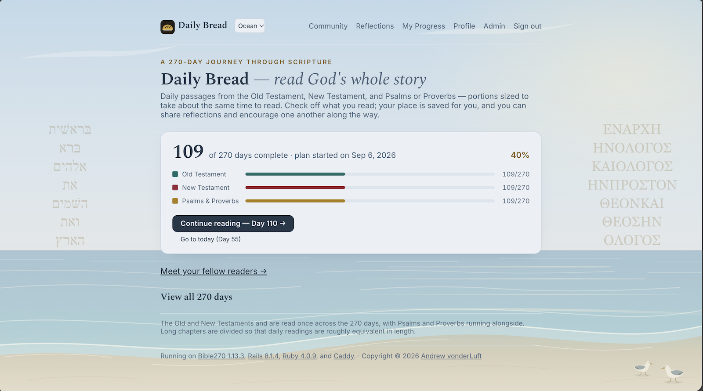
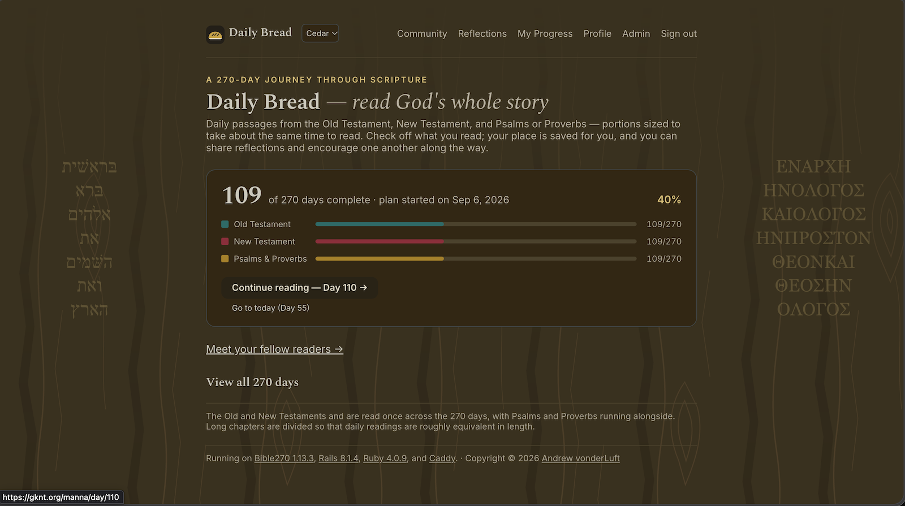
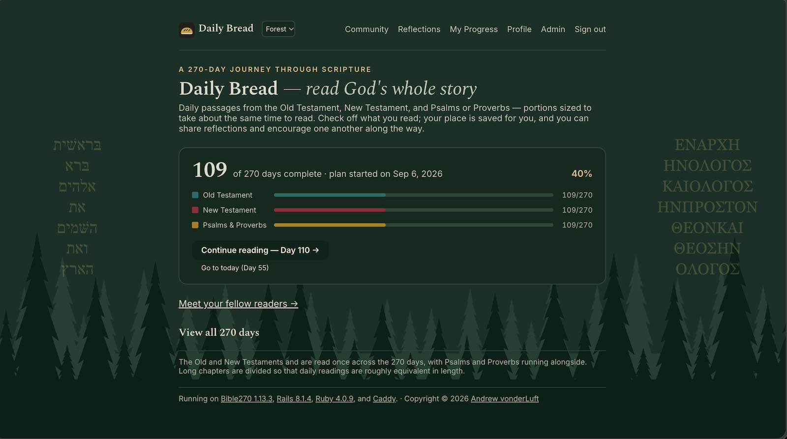
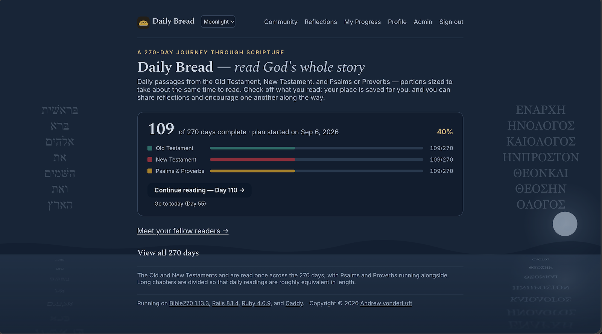

# Bible 270

[](https://github.com/avonderluft/bible270/actions/workflows/railsci.yml) [](https://coveralls.io/github/avonderluft/bible270?branch=main) [](https://rubygems.org/gems/bible270) [](https://rubygems.org/gems/bible270) [](https://github.com/avonderluft/bible270/releases)

A **Rails engine** for a 270-day (9-month) Bible reading plan. Readers check off readings, share reflections, and follow one another's progress.

Created for [Kingdom Movement School of Ministry](https://www.kmsm.life/) and designed to work with [ComfyMiddleSeat](https://github.com/avonderluft/comfy-middle-seat) CMS, it also works in other Rails apps.

See the [architecture walkthrough](docs/architecture.md) for implementation details and the [changelog](CHANGELOG.md) for release history.

## The plan

Three tracks every day, balanced by **verse count**:

- **Old Testament** — once through Genesis–Malachi, excluding Psalms and Proverbs.
- **New Testament** — once through, with longer chapters divided to fill 270 days.
- **Psalms & Proverbs** — once each, interleaved over days 1–269, then **Psalm 1 again on day 270**. Proverbs 31 finishes on day 269; Proverbs occupies 91 days.

By default, psalms of 25 verses or fewer stay whole. Longer chapters use selected breaks or balanced divisions; **Psalm 73 stays whole**, **Psalm 69 splits into verses 1–19 and 20–36**, and **Psalm 119 has eleven 16-verse readings** (two acrostic stanzas each). Parts of a divided chapter always fall on consecutive days. See [Tuning the plan](#tuning-the-plan) for overrides.

The Old Testament and Revelation 22 finish on day 270 alongside Psalm 1. Daily readings average about 115 verses (range 76–166).

`Bible270::Plan` generates the schedule from `Bible270::Versification`, not the database. **Progress and reflections are public.**

Community lists readers alphabetically. Signed-in readers, including admins in non-admin view, see progress bars and completed-day counts. A line marks today on active schedules, except undated, future, or ended ones. Visitors see names and join dates; management links and ahead/behind labels are admin-only.

## Requirements

- **Ruby >= 3.2** and a **Rails >= 7.2** host app. CI covers selected combinations through Ruby 4.0 / Rails 8.1; check your host's dependencies before upgrading Ruby.
- Turbo JavaScript for check-offs without a page reload. The gem includes `turbo-rails`; ordinary HTML forms remain available without JavaScript.
- For picture uploads and backfills: **Active Storage** and **libvips** with PNG, JPEG, GIF, and WebP support on each upload/backfill host. Install with `sudo apt-get install libvips-tools` (Ubuntu) or `sudo pacman -S libvips` (Arch). The gem includes `image_processing` and `ruby-vips`; libvips loads only for optimization, not avatar display.

JavaScript controls show pending, success, and retry feedback. Repeating a request keeps the intended check-off or like state.

## Install

Run installation commands from the **host Rails application**.

```ruby
# Gemfile
gem "bible270"
```

<details>
<summary>Other sources</summary>

Use one of these instead:

```ruby
gem "bible270", git: "https://github.com/avonderluft/bible270.git", branch: "main"
gem "bible270", path: "<path_to_your_local_copy>/bible270"
```
</details>

```bash
bundle install
bin/rails generate bible270:install
```

The interactive generator:

1. Chooses the mount path and email/OmniAuth sign-in methods.
2. Adds known OmniAuth strategy gems and offers to bundle them.
3. Offers to install Active Storage for avatars, copies migrations, and offers to run them.
4. Writes `config/initializers/bible270.rb` and, for social sign-in, `omniauth.rb`.
5. Adds `mount Bible270::Engine, at: Bible270.config.mount_at` to your routes.

Defaults use `/daily-bread` with email and GitHub sign-in. **Configure mail delivery, provider credentials, and OAuth callback URLs** as listed by the generator. Migrations run before initializers are written; the copied migrations belong to your app, with no duplicate engine migration path.

For non-interactive setup:

```bash
bin/rails generate bible270:install --defaults \
  --mount-at=/daily-bread --providers=github,google_oauth2 \
  --mailer-from=no-reply@example.org --no-migrate
```

| Flag | Effect |
|------|--------|
| `--defaults` | Skip prompts; use supplied options and defaults |
| `--mount-at=PATH` | Mount path (default `/daily-bread`) |
| `--providers=a,b` | OmniAuth providers; `--providers=` for none |
| `--email` / `--no-email` | Enable or disable email sign-in |
| `--mailer-from=ADDR` | From address for sign-in emails |
| `--bundle` / `--no-bundle` | Run or skip bundling added strategy gems |
| `--migrate` / `--no-migrate` | Run or skip migrations |
| `--active-storage` / `--no-active-storage` | Install or skip missing Active Storage tables |

Re-running skips existing strategy gems and reuses the mount, moving it above catch-all routes if needed. Rails prompts before overwriting initializers. Complete any skipped bundling or migrations before using affected features.

<details>
<summary>Manual installation</summary>

```ruby
# config/initializers/bible270.rb
Bible270.configure do |config|
  config.mount_at = "/daily-bread"
  config.email_sign_in = true
  config.mailer_from = "no-reply@example.com"
  config.omniauth_providers = [] # email only; see Authentication for OmniAuth
end
```

```ruby
# config/routes.rb — before catch-all routes
mount Bible270::Engine, at: Bible270.config.mount_at
```

```bash
bin/rails bible270:install:migrations
bin/rails db:migrate
```

For picture uploads, also enable and install Active Storage if missing:

```bash
bin/rails active_storage:install
bin/rails db:migrate
```

Configure Action Mailer delivery and, if needed, [OmniAuth](#social-sign-in).
</details>

### Upgrading

**Back up the host database before migrating.** From the host Rails app (no generator re-run needed):

```bash
bundle update bible270
bin/rails bible270:install:migrations # skips existing copies
bin/rails db:migrate
```

Review the [changelog](CHANGELOG.md) before deploying and run **all current migrations**, not just those for features you use.

- `20260101000024` saves existing readers and progress as the first run. **This migration cannot be rolled back without losing run history.** Keep a pre-migration backup for recovery.
- `20260101000025` enables admin roles in the panel. Configured admins become Site-admins and keep their access.
- `20260101000026` saves restart snapshots so future new runs can be reverted.

**Schedule changes do not remap existing day-based check-offs.** Compared with 1.13.3, the current default Psalms/Proverbs assignments differ on days 112–113 and 117–270, including the closing Psalm 1 reading. Review the effect on an active group before upgrading.

### Reconciling a copied database

A copied database may already contain the tables but have migration versions that differ from your app's timestamped copies. Preview reconciliation first:

```bash
bin/rails bible270:migrations:reconcile
```

The task matches Bible270 and generated Active Storage migrations by name, then checks tables, columns, indexes, and foreign keys—not just table existence. **Review the preview and back up the database** before applying:

```bash
APPLY=1 bin/rails bible270:migrations:reconcile
bin/rails db:migrate
```

Preview writes nothing. Apply records verified versions in `schema_migrations`, without changing application tables. Missing changes remain pending for `db:migrate`.

## Mount point

Set the path in one place:

```ruby
# config/initializers/bible270.rb
Bible270.configure do |config|
  config.mount_at = "/daily-bread"
end
```

Routes use `mount_at`; OmniAuth uses `Bible270.config.auth_path_prefix` (`"<mount_at>/auth"`). Engine sign-in links use `request.script_name` at runtime. `"read270"`, `"/read270"`, and `"/read270/"` normalize to `/read270`; nested paths and `/` also work.

When moving the mount, update **provider-dashboard OAuth callback URLs** and **CMS links** manually. Set `config.omniauth_path_prefix` only if OmniAuth needs a separate path.

> **Load order matters:** `bible270.rb` must load before `omniauth.rb`. Rails' alphabetical initializer order handles these names. If you rename them, preserve that order or set `mount_at` in `config/application.rb`.

## Authentication

Use passwordless **email links**, **OmniAuth social sign-in**, or both. Set `omniauth_providers = []` for email-only or `email_sign_in = false` for social-only. Reading is public; participation requires a reader account by default.

### Email links

Configure working Action Mailer delivery and a permitted sender address:

```ruby
Bible270.configure do |config|
  config.email_sign_in = true
  config.mailer_from = "no-reply@example.com"
  config.email_sign_in_ask_name = true
  config.email_sign_in_require_name = true   # first and last name
  # config.email_sign_in_ttl = 20 * 60       # link lifetime in seconds
  # config.email_sign_in_max_per_window = 5  # requests per address
  # config.email_sign_in_window = 15 * 60
  # config.email_sign_in_deliver_later = true # requires an Active Job worker
end
```

- Links are single-use and expire after 20 minutes by default. Tokens are 256-bit and URL-safe.
- Only a **SHA-256 token digest** is stored, not the raw token or a password. Records still contain personal data, including email addresses.
- All valid-address requests get “Check your inbox,” whether known, unknown, or rate-limited, to avoid revealing accounts.
- Names come from the reader or email address (`mary.anne.smith@…` → “Mary Anne Smith”). Email readers use `provider: "email"`.
- Schedule `Bible270::SignInToken.sweep!` to remove expired or consumed records older than seven days by default.

### Social sign-in

The installer adds known strategy gems, writes the initializer, and prints callback URLs to register, such as `https://example.com/daily-bread/auth/github/callback`. The gem already includes `omniauth` and `omniauth-rails_csrf_protection`.

To add a provider manually, install its strategy gem, list it in `config.omniauth_providers`, and register it with OmniAuth:

```ruby
# config/initializers/omniauth.rb
Rails.application.config.middleware.use OmniAuth::Builder do
  # Applies to providers declared below; Builder has no path_prefix method.
  options path_prefix: Bible270.config.auth_path_prefix
  provider :github, ENV["GITHUB_CLIENT_ID"], ENV["GITHUB_CLIENT_SECRET"]
end

OmniAuth.config.on_failure = proc { |env| Bible270::SessionsController.action(:failure).call(env) }
```

```ruby
# config/initializers/bible270.rb
Bible270.configure do |config|
  config.mount_at = "/daily-bread"
  config.omniauth_providers = [:github] # or [:github, [:google_oauth2, "Google"]]
  config.parent_controller = "::ApplicationController"
end
```

**Sign-in must POST with a CSRF token** to `<mount>/auth/:provider`. The engine uses `button_to`; do the same for custom controls. OmniAuth 2 rejects GET sign-in to address [CVE-2015-9284](https://nvd.nist.gov/vuln/detail/CVE-2015-9284).

The engine accepts only local return paths and resets the session on sign-in and sign-out to prevent session fixation. It stores provider, uid, name, email, and avatar URL, not OAuth access tokens or passwords.

### Use your own users

Set a resolver to use host authentication instead of the engine's reader-session lookup:

```ruby
config.current_reader_resolver = lambda do |controller|
  user = controller.send(:current_user)
  next nil unless user
  Bible270::Reader.for_owner(user, display_name: user.try(:name) || user.email,
                             email: user.try(:email), avatar_url: user.try(:avatar_url))
end
```

`Reader.for_owner` links any host model polymorphically. CMS administrator authentication is separate from public-reader authentication; email or OmniAuth is usually simpler for public visitors.

## Admin panel

The panel at `<mount>/admin` returns **404** for unauthorized readers. Configure Site-admins in the host initializer:

```ruby
config.admin_emails = %w[andrew@example.org]
# or
config.admin_resolver = ->(reader) { reader.email.to_s.end_with?('@example.org') }
```

The generated initializer labels this section **Site-admins**; the option names remain `admin_emails` and `admin_resolver`. A callable resolver takes precedence over the email list.

- **Site-admins** can grant or revoke admin access on any reader's Admin page, including alumni, and delete other admins. Configured Site-admins cannot be demoted or deleted in the UI.
- **Admins** manage readers but cannot change roles or delete privileged readers.
- Roles persist across runs, independently of **Active/Alumni** status. Site-admins can change their own membership status.

Authorized readers get an **Admin** link. **View as non-admin** hides admin details and disables all administration for this session, including role and membership changes. You remain signed in; reflections and active check-offs still work. Use **Return to admin view** in the Admin tab or sign in again to restore access. Roles and other sessions are unchanged.

The panel supports:

- Sort active readers by name, completed days, activity, or consistency; **Reader Stats** follows the same sort.
- Edit profiles, themes, and notification preferences. Editing another reader's theme leaves yours unchanged.
- Adjust active readers' start dates; check-offs stay tied to day numbers.
- Set progress through day N, **clearing completions after N**, or toggle individual days.
- Mark readers as alumni, reactivate them, and view past-run history.
- Delete unprotected readers **and all their check-offs and reflections across runs**.
- Hide (reversibly) or delete reflections at `<mount>/admin/comments`. Posts are public immediately, without approval.
- Send individually addressed email: **Write to everyone** reaches active readers; **Write to all admins** includes alumni admins. Both require an email address.

To print a progress report ordered by completed days:

```bash
docker compose exec -e RAILS_ENV=production rails bin/rails bible270:readers:list
```

The report defaults to active readers, showing completed days, last activity, and status: on track, ahead, behind, or undated.

### Runs and alumni

At the bottom of Admin, enter a start date, choose **Start a new run**, and accept the confirmation prompt. This:

- Archives the current memberships and freezes their calendars and statistics.
- Makes all current Admins and Site-admins active in the new run, with zero progress and no personal start date. Previous progress stays in read-only history.
- Leaves other readers as alumni and opens enrollment, even if the installation started with `config.enrollment_open = false`.
- Keeps reader accounts, photos, check-offs, reflections, replies, likes, and admin roles.

**Revert to previous run** restores the reader statuses, personal dates, shared-date override, and enrollment settings saved before the restart. Everyone, including Admins and Site-admins, returns to their saved status; readers who joined only the newer run become alumni. Both runs' progress and discussions are kept, and admin roles do not change. Accept the confirmation prompt to proceed. Revert is available only for restarts made after migration `20260101000026`; earlier states cannot be reconstructed safely. Restored settings without an override follow the current site configuration.

Alumni can sign in, view Community's **active-reader list**, and post, reply to, and like reflections. Earlier reflections remain visible under the same moderation rules. Archived check-offs are read-only and excluded from current statistics and daily completer lists.

**Show / Hide Alumni** at the bottom of Admin uses the browser's built-in expandable section, starting collapsed like **View all 270 days**. It needs no JavaScript or reload and changes no membership. It uses the selected sort and frozen reader statistics; the main list and Reader Stats show active readers only.

Only admins reactivate alumni; signing in or posting does not re-enroll them:

- **New run:** zero completions and no personal start date; old history stays intact.
- **Same run:** progress and personal start date are preserved.

Each reader's **Past runs / history** table shows read-only start/end dates, archive date, and completed days.

Admin templates include `bible270/shared/admin_confirmations`, even with custom layouts. Keep this partial in host template overrides; no layout include is needed.

### Consistency ranking

Consistency is the average end-of-day score on a dated schedule:

`100 + 5 × min(days ahead, 7) − 10 × days behind`

A score of 100 means on track on average, not 100%. Negative scores display as `0` but keep their true ranking. All Admin sorts show scores, on-track/ahead percentages, and evaluated-day counts; consistency sort adds an explanation and **Rank** column.

- Evaluation runs from the later of plan start or joining the run (`joined_at`) through the earlier of yesterday or plan end, in the plan's time zone. Archives use frozen dates and stop before the archive date. Joining late does not reset the scheduled day.
- A day counts when all required readings are checked off, using the latest check-off timestamp. Early completions carry forward; today's catch-up does not improve previous evenings.
- Readers with seven or more evaluated evenings rank first, then **Provisional** readers with one to six, then **Not ranked** readers with none.
- Rank uses unrounded score, then on-track/ahead percentage, then evaluated days. Ties share ranks (`1, 1, 1, 4`), ordered by name and ID. Unranked readers show a dash.

This is **reconstructed history, not an audit log**. Rechecking readings, bulk progress edits, or date changes can alter active-run scores. Completion timestamps record entry time, not necessarily reading time. No snapshot job is required.

## Reflections and notifications

Reflections are ordered by latest approved reply, with day/author filters, page navigation, and new-activity indicators.

Drafts stay in this browser for up to **30 days**, clearing after a successful post. Blocked or full storage triggers a warning but does not prevent posting. **Clear browser storage on shared devices** to remove drafts.

Type `@` for up to five reader-handle suggestions; manual mentions work without JavaScript. **Formatting** adds bold, italic, quotations, lists, links, and YouTube videos. **Preview** applies the same safety filtering as posts. Existing reflections stay plain text unless converted; without migration `20260101000021` (`body_format`), the composer also uses plain text.

With `config.mention_notifications` enabled, readers or admins can choose email for all reflections/replies, only direct replies and mentions, or none. Broad notices use BCC and exclude alumni. Personal notices are individually addressed and still reach opted-in alumni; saved preferences are kept.

Migration `20260101000018` adds broad notifications without changing existing choices; `20260101000022` makes them the default for new readers only. Follow [Upgrading](#upgrading) to install these and the visit-tracking migration (`20260101000017`).

To **override every existing reader's preference** with “Every new reflection and reply”:

```bash
bin/rails bible270:notifications:enable_all
```

With Docker Compose:

```bash
docker compose exec -e RAILS_ENV=production rails bin/rails bible270:notifications:enable_all
```

### YouTube videos

The **Video** button accepts YouTube watch, share (`youtu.be`), Shorts, live, and embed URLs, plus an optional name. It inserts a marked Markdown link in its own paragraph:

```markdown
[YouTube video](https://www.youtube.com/watch?v=aB3_dE-fG12 "bible270-video")
```

Preview and posts show **View video** or **View video ‘Name’**. No remote thumbnail or player loads until playback is requested. The player uses `www.youtube-nocookie.com` without autoplay. **Loading it shares the reader's IP address and request metadata with YouTube**; privacy-enhanced mode is not anonymous.

**Open on YouTube** works without JavaScript or when embeds are blocked, opening a new tab with `rel="nofollow ugc noopener"`. Emails use ordinary links with the optional name. Unmarked or unsupported links stay links; start times and playlists are not retained. No API key, extra gem, or migration is needed; uploads are not supported.

For a host Content Security Policy (CSP), add `https://www.youtube-nocookie.com` to existing **`frame-src`**; do not replace the policy or allow arbitrary frames. Custom layouts must render `bible270/shared/video_embeds` once.

## Themes

Choose **Papyrus**, **Meadow**, or **Ocean** for light themes; **Cedar**, **Forest**, or **Moonlight** for dark themes; or **System** to follow the device (Papyrus/Cedar). System is the default for visitors and new readers.

Signed-in readers can choose a theme beside the app title or under **Profile → Theme**. Header, Profile, and Admin selections save immediately with JavaScript; without it, use Save. Older installations need migration `20260101000023`; see [Upgrading](#upgrading).








Custom layouts must render the shared styles and set the `.b270` element's `data-display-mode` to `current_reader&.effective_display_mode || 'system'`.

## Start dates

The plan can be **undated** (day numbers only) or **dated**:

```ruby
config.start_date = Date.new(2026, 9, 6) # Date, Time, or "YYYY-MM-DD"; nil = no shared date
config.allow_reader_start_date = true
```

| `start_date` | `allow_reader_start_date` | Behavior |
|---|---|---|
| nil | true *(default)* | Personal start date set on first check-off; admins can adjust it |
| a date | true | Shared date unless an admin assigns a personal date |
| a date | false | Shared date for everyone; stored personal dates ignored |
| nil | false | Fully undated |

Dated active plans show dates, a **Today** badge, and “Go to today.” Admins can override the shared `config.start_date` without deploying, reset it, or adjust personal calendars. Changes immediately shift dates, Today, and reminders for affected active readers. **Check-offs and reflections stay tied to day numbers.** Archives keep their frozen calendar (including undated ones), with no Today marker; later date or calendar-setting changes do not affect them. Changing the start date does not [start a new run](#runs-and-alumni).

Date helpers work without Rails:

```ruby
Bible270::Plan.date_for(1, "2026-09-06")          # => Sun, 06 Sep 2026
Bible270::Plan.end_date_for("2026-09-06")         # => Wed, 02 Jun 2027 (day 270)
Bible270::Plan.day_for(Date.current, start)       # clamped to 1..270
Bible270::Plan.day_for(date, start, clamp: false) # may return -3 or 271
Bible270::Plan.before_start?(date, start)
```

## Daily reading reminders

Reminders require host enablement and reader opt-in; both default to off. Profile offers quarter-hour times (default `08:00`), preserving older off-quarter choices until changed. Times use the **plan's time zone**, shown in Profile, not the device's.

```ruby
# config/initializers/bible270.rb
Bible270.configure do |config|
  config.daily_reminders = true
  config.mailer_from = "no-reply@yourdomain.com"
  config.mailer_host = "yourdomain.com" # day/profile links
  # config.time_zone = "America/Los_Angeles" # nil follows the server's clock
end
```

Install the reminder migration (`20260101000016`) via [Upgrading](#upgrading). Bible270 does **not** install a scheduler. Run this task every 15 minutes using your host's cron, platform scheduler, or recurring-job system:

```bash
bin/rails bible270:reminders:send
```

For cron, run `crontab -e` as the application account and use absolute paths:

```cron
*/15 * * * * cd /absolute/path/to/application && RAILS_ENV=production bin/rails bible270:reminders:send >> /absolute/path/to/application/log/bible270-reminders.log 2>&1
```

For Docker Compose, use `pwd` in the Compose directory and `command -v docker` to find the paths. Run cron as an account with Docker access:

```cron
*/15 * * * * cd /absolute/path/to/application && /usr/bin/docker compose exec -T rails bin/rails bible270:reminders:send >> /absolute/path/to/application/log/bible270-reminders.log 2>&1
```

`-T` disables the interactive terminal that cron cannot provide. Verify with `crontab -l` and check the log after the next interval. **Run one scheduler per database**, not one per web container.

The task uses `deliver_now` on the first run at or after the chosen local time, recording the sent date only after success. It skips alumni, already-sent dates, undated or out-of-range calendars, completed days, blank emails, and readers not opted in. Failures are logged without stopping other deliveries; each run prints a delivered count.

## Avatar optimization

Profile and Admin uploads produce a **256×256 static WebP at quality 85**: auto-oriented, center-cropped, converted to sRGB, and stripped of thumbnail metadata. Transparency is preserved; animations use the first frame and small images are upscaled. Actual image data is validated, regardless of filename or declared type.

Limits are **2 MiB** by default (`config.avatar_max_bytes`) and **40 million pixels** in the selected frame/container canvas. The pixel limit bounds dimensions, not total processor memory. Processing or storage failure leaves the previous picture and profile details unchanged.

The original, **including its metadata**, stays in `avatar`; `avatar_thumbnail` holds the display image. This allows reprocessing, not picture history: storage grows even as downloads shrink. Replacing or removing a picture detaches the old pair; **keep Active Job workers running** for purge jobs. No migration is needed if Active Storage is installed.

On desktop, hover over an avatar for **3 seconds** to preview the uncropped original, fitted to the viewport with a 200 ms fade. The original is fetched on demand; touch behavior is unchanged.

### Backfill existing uploads

Existing uploads display their originals until optimized. Run from the **host Rails app** with its normal database/storage credentials and the appropriate environment. Back up the database and storage before a production backfill.

```sh
# Metadata-only preview: no downloads or attachment changes
RAILS_ENV=production bundle exec rake bible270:avatars:optimize DRY_RUN=1

# Process sequentially in bounded batches
RAILS_ENV=production bundle exec rake bible270:avatars:optimize BATCH_SIZE=100

# Rebuild current thumbnails from retained originals
RAILS_ENV=production bundle exec rake bible270:avatars:optimize FORCE=1
```

- Skips current thumbnails, protects concurrent avatar changes, and continues after failures, exiting nonzero if any fail. Fix files, limits, storage access, or processor dependencies, then rerun.
- Reports reader IDs, counts, and original/optimized **display-byte totals**, not storage savings.
- `BATCH_SIZE` defaults to 100 (range: 1–1000). Dry-run checks eligibility, not file availability or decodability.
- Reads originals and writes thumbnails; remote storage may incur request/transfer costs. Provider avatars and unrelated host attachments are untouched.

Host uploads should use `reader.attach_avatar(upload)` or `Bible270::AvatarImages.update!(reader, attributes, upload: upload)`; direct attachment bypasses optimization. **Run uploads and backfills outside caller-owned database transactions** to avoid orphaned files after rollback. Failed cleanup retains unattached blob records and storage keys for retry; use logged blob IDs in host cleanup.

## Configuration reference

Common settings (example sender and host values must be replaced):

```ruby
Bible270.configure do |config|
  config.mount_at = "/daily-bread"
  config.app_name = "Daily Bread"
  config.tagline = "Journeying through Scripture in 9 months"
  config.admin_emails = %w[andrew@example.org] # Site-admins

  config.start_date = nil                  # no shared calendar by default
  config.allow_reader_start_date = true
  config.time_zone = nil                   # server clock, or a named zone
  config.daily_reminders = false           # schedule reminders:send separately
  config.mention_notifications = true      # readers choose notification scope
  config.mailer_host = "example.com"       # reminder/notice links

  config.parent_controller = "ActionController::Base" # or "::ApplicationController"
  config.layout = "bible270/application"

  config.email_sign_in = true
  config.mailer_from = "no-reply@example.com"
  config.email_sign_in_ttl = 20 * 60
  config.email_sign_in_ask_name = true
  config.email_sign_in_require_name = true
  config.omniauth_providers = [:github]
  config.omniauth_path_prefix = nil         # derive "<mount_at>/auth"
  config.current_reader_resolver = nil      # bridge host authentication
  config.require_sign_in_to_participate = true
  config.remember_for = 365 * 24 * 60 * 60   # seconds; nil/0 = session only

  config.after_sign_in_path = nil           # plan root
  config.after_sign_out_path = nil
  config.avatar_max_bytes = 2 * 1024 * 1024
  config.bible_version = "NKJV"
end
```

See [Authentication](#authentication), [Tuning the plan](#tuning-the-plan), and [`Configuration`](lib/bible270/configuration.rb) for additional options.

### Footer

Replace the engine's plan note with a host partial or HTML, or disable it:

```ruby
config.footer_partial = 'shared/footer' # app/views/shared/_footer.html.erb
# Alternatives:
config.footer_html = '<p>&copy; 2026 …</p>'
config.footer = false
```

To include both the engine note and your footer:

```ruby
config.footer_placement = :after   # engine, then yours
config.footer_placement = :before  # yours, then engine
config.footer_placement = :replace # default
```

Host partials can use host view paths, but engine controllers do not automatically include host helpers. If needed, add `helper ::ApplicationHelper` to the engine controller or keep the partial self-contained.

### Favicon

The engine layout uses an inline SVG loaf favicon, with no asset-pipeline setup:

```ruby
config.favicon = nil                  # built-in loaf (default)
config.favicon = '/icons/my-icon.svg'  # custom
config.favicon = false                # omit the engine's favicon
```

For a custom layout, add `<%= b270_favicon_tag %>` to `<head>`.

### Scripture links and popups

References link to **Bible.com** by default. Readers and admins can select **Bible Gateway** or **Blue Letter Bible** in reader preferences. Bible.com opens whole chapters. Scripture links reuse one browser tab; Ctrl/Cmd-click, middle-click, or the context menu can open additional tabs.

Original-language options exclude Bible Gateway:

| Option | Bible.com | Blue Letter Bible |
|---|---|---|
| `HEB/GRK` | WLC Old Testament; THGNT New Testament | WLC Old Testament; mGNT New Testament |
| `ALLGRK` | GRCBRENT Old Testament; THGNT New Testament | mGNT/LXX route for all tracks |

[Blue Letter Bible ScriptTagger](https://www.blueletterbible.org/webtools/BLB_ScriptTagger.cfm) adds Scripture-reference hover popups to reflections and replies, using the reader's translation or the site default. `HEB/GRK` and `ALLGRK` select languages by testament. The engine layout loads it automatically; custom layouts should render this once near the end of `<body>`:

```erb
<%= render "bible270/shared/scripture_popups" %>
```

ScriptTagger loads remote JavaScript and CSS. Add `https://www.blueletterbible.org` to existing CSP **`script-src`** and **`style-src`** directives. Page loads share the visitor's IP address and request metadata with BLB; hovering also sends the reference and selected translation.

## With ComfortableMediaSurfer

Mount the engine and add a CMS navigation link to use its own themed pages. To use your host's header and footer, set `config.parent_controller = "::ApplicationController"` and `config.layout = "layouts/application"`. Include the shared styles, theme attribute, and script partials described above when supplying a custom layout.

## Data model

| Table | Holds |
|-------|-------|
| `bible270_readers` | Identity, provider/uid or polymorphic owner, personal start date, preferences, and persistent `admin` boolean |
| `bible270_plan_runs` | Current-run marker, shared start date, and archive timestamp |
| `bible270_participations` | One membership per reader/run (unique pair), Active/Alumni status, `joined_at`, personal date, archive date, and frozen effective start date |
| `bible270_checkoffs` | Reader and participation references; one row per participation/day/track/part, protected by a unique index |
| `bible270_comments` | Day/track reflections and replies, stored as plain text or safely rendered Markdown |
| `bible270_likes` | Reader likes on comments |
| `bible270_settings` | Current shared-date override, enrollment state, and administrative settings |
| `bible270_sign_in_tokens` | Email, token digest, expiry, and consumption time |

A complete day requires all parts of all three tracks. Progress uses the current membership, or the latest historical one if absent; runs are never added together. Reflections, replies, and likes belong to readers and remain shared across groups. **Progress and visible reflections are public, not private journals.**

## Routes (inside the mount point)

Selected reader routes; see [`config/routes.rb`](config/routes.rb) for the full list, including Admin and Profile actions.

```text
GET    /                              days#index
GET    /day/:day                      days#show
POST   /day/:day/toggle/:track/:part   checkoffs#toggle
POST   /day/:day/toggle/:track         checkoffs#toggle (first part)
POST   /day/:day/comments              comments#create
GET    /reflections                   comments#index
POST   /comments/preview              comments#preview
PATCH  /comments/:id                  comments#update
DELETE /comments/:id                  comments#destroy
POST   /comments/:id/like             likes#toggle
GET    /community                     readers#index
GET    /mention-suggestions           readers#mention_suggestions (signed-in JSON)
GET    /readers/:id                    readers#show
GET    /progress                      readers#progress
GET    /sign_in                       sessions#new
POST   /sign_in/email                 sessions#email_link
GET    /sign_in/email/:token          sessions#email_callback
GET    /auth/:provider/callback       sessions#create
POST   /auth/:provider/callback       sessions#create
GET    /auth/failure                   sessions#failure
DELETE /sign_out                      sessions#destroy

POST   <mount>/auth/:provider         OmniAuth middleware, not the engine
```

## Tuning the plan

Prefer host configuration to editing the gem. Break points list the **last verse of each reading except the final one**; `[]` keeps a chapter whole:

```ruby
config.chapter_breaks = {
  'Luke 1' => [25, 56],        # 1–25, 26–56, 57–80
  'Psalm 78' => [20, 39, 55]   # 1–20, 21–39, 40–55, 56–72
}
config.chapter_breaks_path = Rails.root.join('config/bible270_breaks.yml')
```

```yaml
# config/bible270_breaks.yml — re-read when changed
Psalm 35: []
Psalm 78: [20, 39, 55]
```

Precedence is built-in `CHAPTER_BREAKS`, then `config.chapter_breaks`, then YAML. Ruby keys may also be arrays such as `['Luke', 1]`. Explicit breaks override default division rules, including Psalm 119's sections.

| `Bible270::Plan` constant | Default | Purpose |
|---|---|---|
| `DAYS` | `270` | Plan length |
| `PSALM_WHOLE_MAX_VERSES` | `25` | Keep shorter psalms whole unless explicitly overridden |
| `PSALM_119_SECTION_SIZE` | `16` | Default verses per Psalm 119 section |
| `CHAPTER_BREAKS` | Built-in chapter map | Selected breaks and whole-chapter overrides |

For New Testament and Psalms/Proverbs, explicit breaks fix a chapter's reading count; other chapters divide by verse load to fill remaining days, using equal parts. Psalms/Proverbs reserves the final day for Psalm 1.

Breaks must be ascending, distinct, and inside the chapter; invalid entries or too many pinned readings raise `ArgumentError`. Cached results refresh when breaks change. No schedule migration is needed, but **changed assignments do not remap check-offs or reflections**. Test custom schedules before using them with an active group.

## Scaling

Community pages calculate completed days from grouped check-offs in Ruby. For large groups, profile this first; a cached `days_completed` counter on `Reader`, updated after check-off commits, is one possible optimization.

## Troubleshooting

**404 on the provider callback**

Match OmniAuth's `path_prefix` and the registered callback URL to the mount. Use `Bible270.config.auth_path_prefix` and check [initializer load order](#mount-point).

**Sign-in button does nothing, or `OmniAuth::AuthenticityError`**

Custom controls must POST with a CSRF token; use `button_to`. Confirm `omniauth-rails_csrf_protection` is bundled.

**No email arrives**

Check Action Mailer settings, an accepted `mailer_from`, and logs. Sign-in uses `deliver_now` unless `email_sign_in_deliver_later` is enabled; then check the Active Job worker too. Delivery errors are hidden from readers to avoid revealing accounts.

**“That link has expired or was already used”**

Request a fresh link. Links are single-use and expire after 20 minutes by default. Mail scanners or preview bots can consume them early; investigate prefetching if it recurs. Increasing `email_sign_in_ttl` helps only with expiry, not consumed links.

**Custom layout is unstyled**

Add `<%= render "bible270/shared/styles" %>` to `<head>`, or style the `b270-*` classes yourself. Also include the theme attribute and shared scripts required by the features you use.

## Development

```bash
bundle install
bundle exec rake test
node --test test/javascript/*.cjs
bundle exec rubocop --cache false
```

`rake test` uses one isolated worker per available CPU, up to eight. Coverage stays enabled at `coverage/index.html`; recorded runtimes in `tmp/parallel_runtime_test.log` balance the work. Large Admin and Profile tests are split by feature, with shared setup in `test/support`.

Use `PARALLEL_WORKERS=4 bundle exec rake test` to choose the count, or `bundle exec rake test:serial` for serial coverage. Logs keep warnings and errors in `test/dummy/log/test-*.log`; set `TEST_LOG_LEVEL=debug` for request, template, and SQL details.

Video UI tests require **Node.js 22+**, use the built-in runner with no npm dependencies, and do not contact YouTube. Check live playback and host CSP separately in a browser. Plan logic is unit-tested without a Rails dependency.

### Get an email link for local testing

From the host app's console (`bin/rails console`):

```ruby
_record, raw = Bible270::SignInToken.issue!("John.Smith@example.com")
Bible270::Engine.routes.url_helpers.email_sign_in_url(token: raw, host: "localhost:3333")
```

Use your local host/port. If `raw` is nil, the address is invalid or rate-limited; no link was issued.

## Contributing

Report bugs or open pull requests at <https://github.com/avonderluft/bible270>.

Fork, clone, and branch from `main` (`git checkout -b my-feature`). Add tests, run the [development checks](#development), and open a pull request against `main` explaining the change.

- Keep plan logic independent of Rails.
- Pin exact expected references in tests for schedule changes.
- Prefix new CSS classes and helpers with `b270`.
- Record user-visible changes in `CHANGELOG.md`.

## License

[MIT-LICENSE](./MIT-LICENSE).
