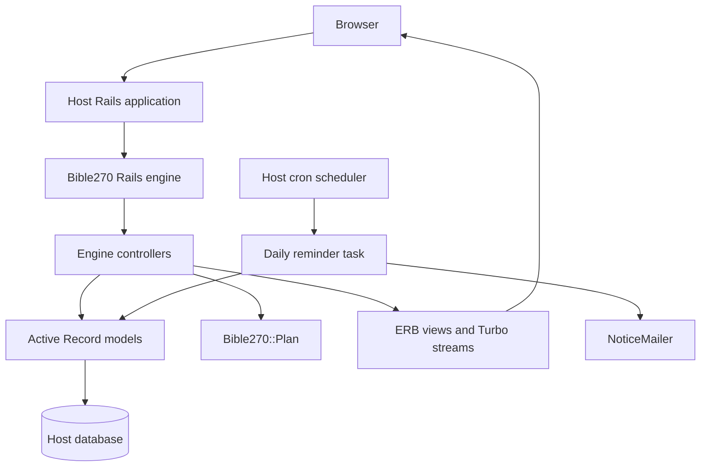
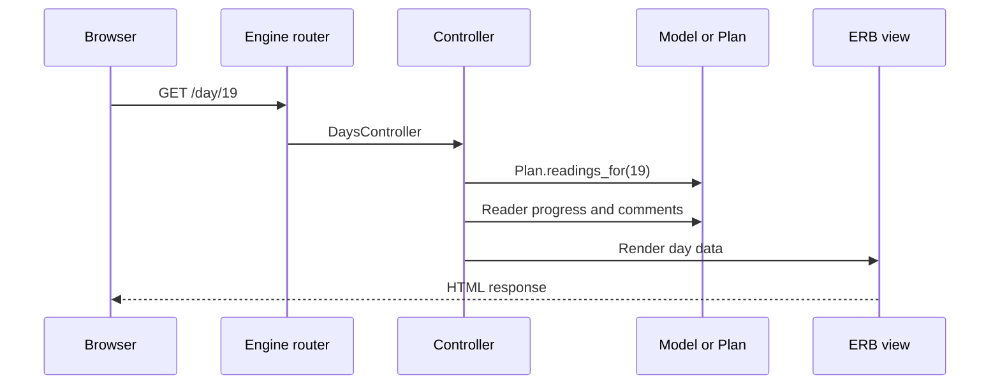

# Bible270 Architecture Walkthrough

This developer reference covers Bible270's request flow, data model, administration, email, and tests. It assumes familiarity with Rails MVC. Keep it aligned with behavior changes, tests, and the changelog.

## 1. Start with the big picture

Bible270 is a mountable Rails engine, not a complete standalone application. A host Rails application installs the gem, configures it, owns the database migrations, and mounts the engine at a path such as `/daily-bread`.



The engine separates the plan from community data:

- The **reading schedule** is deterministic Ruby generated by `Bible270::Plan`; it is not stored in the database.
- **Participation state** is stored: reader identities, plan runs, memberships, checkoffs, reflections, replies, likes, settings, and sign-in tokens. Calendar snapshots preserve historical schedules without duplicating the generated reading plan.

## 2. How the engine boots

The public entry point is `lib/bible270.rb`. It requires the plan and support modules, configuration, reminders, and—when Rails is present—the engine itself.

It also defines Bible270's clock:

- `Bible270.today` returns the plan's current local date.
- `Bible270.local_time(time)` converts timestamps for display and scheduling.
- `Bible270.config.time_zone` overrides the machine's local zone when configured.

`lib/bible270/engine.rb` defines an isolated engine:

```ruby
class Bible270::Engine < ::Rails::Engine
  isolate_namespace Bible270
end
```

Isolation gives the engine its own controllers, models, route helpers, and table namespace without colliding with similarly named host classes.

The engine does not add its migrations to the host's migration paths. The host copies and owns them; see [Settings and migrations](#13-how-settings-and-migrations-are-maintained).

### Host configuration

`lib/bible270/configuration.rb` defines `Bible270.configure` and `Bible270.config`. Its settings cover:

- Host integration: parent controller, layout, current-reader resolver, and mount/authentication paths.
- Sign-in, remembered sessions, and enrollment.
- Shared and optional personal start dates.
- Configuration-controlled Site-admin access; stored Admin grants live on readers.
- Bible translations, Scripture providers, and presentation.
- Mail delivery and daily reminders.

`lib/generators/bible270/install/install_generator.rb` creates the host initializer, copies migrations, adds the mount route, and optionally configures Active Storage and authentication providers. Its template, `lib/generators/bible270/install/templates/bible270.rb.tt`, has a **Site-admins** section. The option names remain `admin_emails` and `admin_resolver`; they configure Site-admins, not stored Admin grants.

## 3. Follow an HTTP request through Rails

The engine routes are all in `config/routes.rb`. The major reader-facing destinations are:

| Destination | Controller action | Purpose |
|---|---|---|
| `/` | `DaysController#index` | Home overview and progress |
| `/day/:day` | `DaysController#show` | One day's readings and reflections |
| `/progress` | `ReadersController#progress` | Signed-in reader's progress |
| `/community` | `ReadersController#index` | Community directory |
| `/readers/:id` | `ReadersController#show` | Public reader page |
| `/reflections` | `CommentsController#index` | Reflection conversations |
| `/profile` | `ProfilesController#edit` | Reader preferences |
| `/sign_in` | `SessionsController#new` | Sign-in choices |
| `/admin` | `AdminController#index` | Operational administration |

Every engine controller inherits from `app/controllers/bible270/application_controller.rb`. It uses the host-configured parent controller and layout, resolves `current_reader` from the session or host callback, exposes shared helpers, and enforces sign-in where required.

A typical request:



## 4. How the 270-day plan is generated

`lib/bible270/plan.rb` is the schedule engine. Canonical chapter and verse data comes from `lib/bible270/versification.rb`.

Key constants are `Plan::DAYS` (270), the `Plan::OT`, `Plan::NT`, and `Plan::PP` tracks, `Plan::TRACKS` (all tracks), and `Plan::CHAPTER_BREAKS` (verse-level divisions).

The tracks are generated differently:

1. **Old Testament:** Psalms and Proverbs are excluded. Whole chapters are grouped into 270 contiguous portions balanced by verse count.
2. **New Testament:** 260 chapters become 270 readings by dividing selected long chapters into verse ranges.
3. **Psalms and Proverbs:** both books are divided and interleaved to fill one 270-day track while keeping sections of a split chapter consecutive.

The principal API is:

- Readings and parts: `Plan.readings_for(day)`, `parts_for(day, track)`, `part_count(day, track)`, `total_parts(day)`.
- Validation: `Plan.valid_day?(day)`, `valid_part?(day, track, part)`.
- Calendar mapping: `Plan.date_for(day, start_date)`, `day_for(date, start_date)`.

A multi-chapter Old Testament reading has one checkoff part per chapter. The New Testament and Psalms/Proverbs readings have one part per daily reading. Completion code therefore uses `Plan.total_parts(day)`, not an assumption that every day has only three checkboxes.

Chapter breaks can come from the built-in constant, configuration, or a YAML path. `Plan.reset!` clears memoized derived values after configuration changes.

## 5. How readers and progress are stored

`app/models/bible270/reader.rb` stores identity and preferences, separate from run membership. Readers own participations and checkoffs, reflections, replies, likes, and an optional Active Storage avatar. A host may supply a polymorphic owner. The stored `admin` boolean is independent of participation status.

`app/models/bible270/plan_run.rb` identifies each group run. Its unique nullable `current` marker permits at most one current run; archived runs retain their shared start date and archive timestamp.

`app/models/bible270/participation.rb` joins a reader to a run. A unique reader/run index prevents duplicate memberships. It stores `active`, `joined_at`, personal `started_on`, `archived_on`, and `frozen_start_date`. Archiving freezes the effective calendar, including an explicitly undated calendar. `Participation.active` requires both an active membership and a current run; readers without one are alumni.

`Reader#participation` selects the newest membership from a non-reverted run, falling back to the newest reverted history only if no other membership exists. The `checkoffs` association exposes only that membership's progress; `all_checkoffs` retains all runs for identity deletion. Reflections, replies, likes, and photos remain reader-owned, not run-scoped.

`app/models/bible270/checkoff.rb` stores one completed part: `reader_id`, `participation_id`, `day`, `track`, and zero-based `part`.

A unique database index prevents duplicate checkoffs for the same **participation**, day, track, and part. The same reader can therefore complete the plan again without replacing earlier progress.

Key `Reader` progress methods:

- Counts and status: `checked_counts`, `checked_count`, `day_status`, `day_complete?`, `days_completed`, `completion_percent`, `current_day`.
- Incomplete work: `partial_days`, `remaining_parts_for`.
- Corrections: `mark_day_complete!`, `clear_day!`, `toggle_day!`, `mark_through!`.

`Reader.completed_days_by_id` performs an aggregate, chapter-aware calculation for each reader's selected participation, never summing across runs. Community uses active readers and loads completion counts for signed-in viewers; group statistics and `Reader.completers_for` exclude historical checkoffs and alumni.

`Reader#archive!` freezes the current membership without changing identity or roles. `Reader#activate!` restores progress and the personal date for a same-run return; joining a different run creates a fresh membership with zero checkoffs and clears the reader's personal date. A restart enrolls admins automatically; other returning alumni require an explicit admin action. Sign-in and social activity never call activation. Newly created readers enroll in the current run.

### Toggling a reading

The checkbox route reaches `CheckoffsController#toggle` in `app/controllers/bible270/checkoffs_controller.rb`.

The action:

1. Requires a signed-in, active reader; alumni progress is read-only.
2. Validates the day, track, and part against `Bible270::Plan`.
3. Locks the run and reader, rechecks membership, and rejects stale membership requests.
4. Adds or removes the exact participation-scoped checkoff.
5. Starts an undated reader when their first checkoff is added.
6. Clears relevant progress memoization.
7. Responds with Turbo Stream updates or an HTML redirect fallback.

Progress mutations also enforce `Participation#ensure_writable!` in the model layer, preventing archived progress edits through Admin or stale requests.

`app/views/bible270/checkoffs/toggle.turbo_stream.erb` updates the reading control, day progress, and completion information without a full reload.

On the final check-off, `shared/_day_completion.html.erb` selects a random Scripture frame server-side. `_day_completion_ui.html.erb`, included by the interaction partial, fades it in over 1.3 seconds, holds it for 5.5 seconds, then plays the optional 1.4-second dove flight. The dove moves and grows throughout the flight, without a stationary segment; a shared parent animation fades both over the flight's final 0.4 seconds. The dove's end event removes the overlay immediately. Without a dove, the frame fades out over 0.2 seconds. The reader's dove opt-out keeps the frame; reduced motion keeps a static 5.5-second frame without flight. Completion IDs prevent replay, and navigation cancels timers and removes the temporary overlay. No extra lookup request is needed.

## 6. How dates and “today” work

Plan history is keyed to plan day numbers, not calendar dates. Changing a start date remaps the calendar without moving checkoffs or reflections.

The shared start date resolves in this order:

```text
Bible270::Setting run-start override
        ↓ fallback
Bible270.config.start_date
```

`app/models/bible270/setting.rb` stores the administrator's current-run override. The Admin panel sets or resets it through `AdminController#update_run_start` and `#reset_run_start`.

`Reader#effective_start_date` then decides the date for one reader:

- An alumni membership uses its frozen effective start date, unaffected by later configuration or shared-date changes.
- For an active membership, when personal start dates are enabled and the reader has `started_on`, that personal date wins.
- Otherwise the shared current-run date applies.
- A nil result means the reader is using an undated plan, including an archived undated membership.

`Reader#progress_today` uses `archived_on` for historical status instead of the advancing clock. Alumni have no Today marker. `ReaderConsistency` evaluates from the later of plan start or membership `joined_at`, through the earlier of yesterday or plan end; archived memberships use the frozen start date and stop before the archive date. `ReaderProgressReport` defaults to active readers. These bounds keep archived schedule status and consistency statistics fixed.

Related `Reader` methods cover calendar mapping (`calendar_day`, `raw_calendar_day`, `today_day`, `date_for_day`, `plan_end_date`), schedule status (`not_started_yet?`, `past_end_date?`, `days_off_pace`), and personal dates (`restart_on!`, `set_start_date!`, `ensure_started!`).

Starting a new run is a separate transaction. `PlanRun.restart!` requires a valid start date and expected current-run ID. It locks the old run and readers, archives every active membership, stores the old shared date, creates the new current run, and opens enrollment. It then enrolls all current Admins and Site-admins with zero checkoffs and no personal date, using configured email addresses, custom resolvers, and stored grants to identify roles. Previous progress stays archived; other readers remain alumni. The saved enrollment-open override takes precedence even if `config.enrollment_open = false` launched closed.

`PlanRun.revert!` requires the expected current-run ID and a restart snapshot. It locks both runs in ID order, archives the newer run, restores the predecessor and its saved active memberships, and restores reader dates and raw runtime settings (including absent overrides). Saved membership statuses are restored equally for all readers, including Admins and Site-admins; already-alumni memberships are untouched. The newer run is marked `reverted_at` and retained as read-only history. Snapshots record the actual predecessor, so repeated restart/revert operations do not depend on adjacent run IDs. Pre-snapshot restarts cannot be reverted safely.

Restart, enrollment, reactivation, and progress writes lock the run first. This serializes conflicting changes and prevents stale submissions from silently changing the new group.

## 7. How sign-in works

`app/controllers/bible270/sessions_controller.rb` supports two built-in sign-in paths:

### OmniAuth

The host application's OmniAuth middleware handles the request phase. The engine receives the callback at `/auth/:provider/callback`, finds or creates a reader, resets the Rails session to prevent fixation, and stores the reader ID.

### Passwordless email

`lib/bible270/email_sign_in.rb` normalizes addresses and generates secure random tokens. `app/models/bible270/sign_in_token.rb` stores only a digest, expiration, and consumption state.

The flow is:

1. The reader submits an email address.
2. `SessionsController#email_link` creates a token and sends a magic link.
3. The browser follows that link to `SessionsController#email_callback`.
4. `SignInToken.claim!` atomically consumes a valid, unused token.
5. The controller finds or creates the reader and starts the session.

An encrypted remember cookie can restore a signed-in reader later. `Reader#remember_token!`, `Reader.from_remember_cookie`, and `Reader#forget!` implement that lifecycle.

A host can replace built-in reader resolution with `config.current_reader_resolver`, which is useful when Bible270 shares the host's existing user system.

## 8. How reflections, replies, mentions, and likes work

`app/models/bible270/comment.rb` represents both top-level reflections and one-level replies.

Replies belong to a top-level reflection on the same plan day; they cannot nest further. Reflections may identify one reading track. Body length is limited, and ordinary public scopes exclude hidden reflections.

`CommentsController` in `app/controllers/bible270/comments_controller.rb` handles listing, creation, editing, and deletion. `Comment.thread_page` paginates conversations as units and orders them by their latest root-or-reply activity. Conversations are shared across runs: earlier groups' reflections stay visible to later groups under the same moderation rules. Alumni can sign in, post reflections, reply, and like without rejoining the current run.

### Mentions and reply notices

`lib/bible270/mentions.rb` parses handles such as `@first` and `@first.last`. Ambiguous short handles resolve to nobody rather than risking notification of the wrong reader. For signed-in writers, `ReadersController#mention_suggestions` supplies at most five prefix-matched public names to the progressively enhanced composer; the server-side parser remains authoritative when the reflection is posted.

After a comment commits, model callbacks send direct reply/mention notices and every-reflection/reply notices. They honor personal and global opt-outs, suppress self-notifications and duplicate direct/broad notices, and do not resend unchanged mentions.

Every-reflection/reply broad notices select active readers only. Personal replies and mentions still reach opted-in alumni; archiving does not erase their notification preferences.

`PlanHelper#b270_with_mentions` escapes all user content and links only successfully resolved mentions.

### Likes

`app/models/bible270/like.rb` stores one row per reader and comment. A unique index enforces that rule. `LikesController#toggle` supports desired-state requests, and its Turbo Stream response replaces only the relevant likes region.

## 9. Community, profile, and Admin responsibilities

### Community

`ReadersController#index` displays **active readers** alphabetically rather than ranking them by progress. Alumni can view this same directory. Signed-in viewers see progress bars and completed-day counts; visitors see identity and joined date. Admin view adds management links and written schedule status. Historical progress does not enter the current directory or daily completer lists.

`ReadersController#show` is a public individual reader page with progress, recent approved reflections, and the day grid.

### Profile

`ProfilesController` manages names, avatar, translation, Scripture provider (Bible.com by default, Bible Gateway, or Blue Letter Bible), reflection email scope (every post, personal replies/mentions, or none), and daily reminder opt-in/time.

Original-language selections default to Bible.com, while also allowing Blue Letter Bible; Bible Gateway remains unavailable. `HEB/GRK` selects Hebrew OT and Greek NT texts. `ALLGRK` selects LXX OT and Greek NT texts.

### Admin

`AdminController` keeps operational controls off reader pages:

- Enrollment, shared dates, and new runs.
- Reader identity, reflection email scope, alumni status, and explicit reactivation.
- Active personal dates and completion corrections; archived calendars and checkoffs stay read-only.
- Reflection moderation, avatar/reader removal, and broadcast email.

At the bottom of Admin, **Start a new run** has an inline start-date field and button, with a native confirmation prompt. The restart described above preserves identities, photos, progress, social activity, and roles. Admins and Site-admins start fresh automatically; other alumni require reactivation. **Revert to previous run** appears as a button at the top of its panel when a saved restart exists and uses a native confirmation prompt.

**Show / Hide Active Readers** uses native `<details open>`, leaving sort controls and Reader Stats outside. `_admin_reader_list_ui.html.erb` remembers its state in tab-local session storage, scoped by mount and an opaque sign-in-session key. It restores the choice after sorting, navigation, and Turbo visits, with an in-memory fallback if storage is blocked; no database preference is saved. The bottom **Show / Hide Alumni** control is initially collapsed, like the day index. Both lists render through `admin/_reader_list.html.erb`, so disclosure needs neither JavaScript nor a reload. Alumni use the selected sort and the same status/consistency statistics, frozen at archive time. Reader Stats remains active-only. Reader details include a read-only **Past runs / history** table with frozen start/end dates, archive dates, and completion counts.

Authorization is separate from participation:

- `Configuration#site_admin?` uses a callable `admin_resolver` in preference to `admin_emails`.
- `Configuration#admin?` accepts Site-admins or readers with a stored `admin == true` grant, including alumni.

Only Site-admins in admin view may use `AdminRolesController` to grant or revoke stored roles, including for alumni. Site-admins cannot be demoted or deleted through the UI. Admins without Site-admin access cannot manage roles or delete privileged readers; Site-admins may delete stored Admins. Unauthorized Admin and role requests return a routing-style 404.

The session-only **View as non-admin** preview disables all administration, including role and membership changes. It retains the Admin link for returning to admin view, without changing identity, roles, or participation.

## 10. How Scripture links are built and opened

`Reader` defines the fixed provider list: Bible.com, Bible Gateway, and Blue Letter Bible. `lib/bible270/translations.rb` generates URLs; arbitrary URL builders are not supported. Bible.com links target whole chapters. `HEB/GRK` uses WLC/THGNT; `ALLGRK` uses GRCBRENT/THGNT. Blue Letter Bible uses mGNT for both `ALLGRK` testaments, with its Old Testament route displaying the LXX. Shared link markup comes through `PlanHelper#b270_passage_link`, ensuring all Scripture links use the same behavior.

The no-JavaScript anchor has a named target and `rel="noopener"`. With JavaScript, `app/views/bible270/shared/_interaction_ui.html.erb` coordinates a script-owned reading window:

- Desktop browsers reuse and focus one retained Scripture tab/window.
- iOS/iPadOS Safari closes the previous script-opened reading tab and opens its replacement because Safari does not reliably foreground an existing background tab.
- Modifier clicks remain under normal browser control.

This avoids creating an unlimited series of reading tabs while preserving a secure fallback.

### Bread-icon Scripture frame

`lib/bible270/scripture_frames.rb` combines the safe-loaded `config/scripture_frames.yml` catalog with enabled `ScriptureFrame` database records. Admin additions supplement the defaults; they never modify YAML. An optional `scripture_frames_path` replaces only the default catalog, with bundled fallback on invalid input. Translation choices and automatic credits combine built-in metadata with the catalog. Choices follow the reader-preference order, then frame-only translations. Registered credits are resolved when displayed, so YAML corrections also reach saved texts.

`ScriptureFramesController#show` serves public, uncached JSON at `/scripture-frame`, avoiding the previous selection when alternatives exist. Default texts work before the custom-text migration is installed. No external API is called.

`AdminScriptureFramesController` provides custom-text CRUD at `/admin/scripture-frames`; shared admin guards reject unauthorized readers and non-admin preview sessions. Default content cannot be edited or deleted, but `PATCH /admin/scripture-frame-defaults/:id` sets its availability. Per-ID disable flags live in the existing `Setting` table; absent flags mean enabled. Both random frame paths filter disabled defaults, while Admin keeps them previewable. These site-wide flags survive restarts and reverts and require no new migration. The main Admin page lists custom passages in biblical order, then custom quotations, then defaults using `admin/_scripture_text.html.erb`. Each row identifies Custom/Default without separate group headings; Add text sits beside Scripture frames and custom actions beside each passage heading. The old Manage texts route redirects to this panel; saves, toggles, deletes, and form Cancel links return here with the selected reader sort. Passage text appears in an escaped, bounded hover/focus tooltip; native tap/Enter expands it inline. `_scripture_library_ui.html.erb` suppresses hover/focus preview after an explicit collapse until fresh pointer entry or focus, so the passage stays hidden when closed. Both states use a contrasting theme surface. Texts belong to the installation, not to a reader or run, so restarts and reader deletion leave them intact.

Custom texts require a reference, translation, and pasted passage (up to 4,000 characters). **Other quotation** uses the existing translation field's `OTHER` value and relabels Reference as Author / source; it has no Bible translation credit. The form updates labels and credits when the selection changes. Both popup and completion frames omit the quotation marker, showing only its source. Enabled quotations join the same random pool; no new migration is needed. The form and model reject blank text; invalid submissions preserve inputs without changing saved records. API retrieval is deferred; no external lookup runs when adding or displaying frames.

The header's bread button starts a three-second fine-pointer hover timer; click, touch, Enter, and Space open immediately. `_scripture_frame_ui.html.erb` fetches text on demand and renders plaintext through `_scripture_frame.html.erb`, with theme-aware styling, dismissal, and stale-request cleanup. Custom layouts using the header must render the styles and `bible270/shared/scripture_frame_ui` once.

## 11. How mail and daily reminders work

The mailers are:

- `app/mailers/bible270/sign_in_mailer.rb` for magic links.
- `app/mailers/bible270/notice_mailer.rb` for registrations, mentions, replies, reminders, and broadcasts.
- `app/mailers/bible270/application_mailer.rb` for shared sender behavior.

Mailer URLs use `config.mailer_host` and preserve the engine's mount prefix.

Reminder and reflection audiences follow the active-reader and alumni rules above. Admin's **Write to everyone** selects active readers with email addresses; **Write to all admins** includes Site-admins and stored Admins, even when alumni. Admin broadcasts are individually addressed.

### Reminder delivery

The opt-in checkbox only records a preference. The host must schedule the delivery task. `Bible270::DailyReminders.deliver(at:)` in `lib/bible270/daily_reminders.rb`:

1. Checks that reminders are enabled and their schema is available.
2. Converts the supplied time into the configured plan time zone.
3. Selects opted-in active readers with email addresses; the mailer also rechecks alumni status before delivery.
4. Checks each reader's selected reminder time.
5. Maps the local date through the reader's effective start date.
6. Skips dates outside the plan and already-completed days.
7. Delivers `NoticeMailer.daily_reminder`.
8. Records `last_daily_reminder_sent_on` only after successful delivery.
9. Isolates one reader's delivery failure from the others.

The task entry point is `lib/tasks/bible270_reminders.rake`:

```sh
bin/rails bible270:reminders:send
```

A typical Docker Compose host polls every 15 minutes:

```cron
*/15 * * * * cd /absolute/path/to/application && /usr/bin/docker compose exec -T rails bin/rails bible270:reminders:send >> /absolute/path/to/application/log/bible270-reminders.log 2>&1
```

Run only one scheduler for each database.

## 12. How the UI is organized

Bible270 keeps its presentation self-contained under `app/views`.

- Main layout: `app/views/layouts/bible270/application.html.erb`
- Shared CSS: `app/views/bible270/shared/_styles.html.erb`
- Header/navigation: `_header.html.erb` and `_nav_links.html.erb`
- Shared progress/grid UI: `_progress.html.erb` and `_day_index.html.erb`
- Shared interaction JavaScript: `_interaction_ui.html.erb`
- Day-completion sequence: `_day_completion.html.erb` and `_day_completion_ui.html.erb`
- Run/membership confirmation JavaScript: `_admin_confirmations.html.erb`, rendered by Admin index/detail templates
- Reflection draft JavaScript: `_comment_drafts.html.erb`
- Mention suggestion JavaScript: `_mention_typeahead.html.erb`
- Scripture frame markup and interaction: `_scripture_frame.html.erb` and `_scripture_frame_ui.html.erb`
- Turbo Stream templates: controller-specific `.turbo_stream.erb` files

The layout uses CSP nonces for inline scripts. JavaScript enhances ordinary forms rather than replacing their server-rendered behavior. Mutation controllers keep HTML redirect fallbacks, while Turbo performs focused updates when available.

Shared interaction code provides pending/success/retry feedback, accessible announcements, double-submit prevention, Turbo cleanup, and Scripture-tab behavior.

`PlanHelper#b270_avatar` displays the optimized avatar but supplies the original uploaded photo (or provider URL) for preview. `app/views/bible270/shared/_avatar_preview_ui.html.erb` shows it after a three-second mouse/pen hover on fine-pointer devices, preserving signed URLs. Leaving, Escape, scrolling, navigation, or a load failure dismisses it.

The mobile navigation behavior lives with the shared header. Admin templates render `bible270/shared/admin_confirmations` automatically, including under a custom layout; no additional layout include is required. Host overrides of those templates should retain it. The partial confirms native and keyboard form submissions before Turbo.

## 13. How settings and migrations are maintained

`Bible270::Setting` is a small database-backed key/value store used for runtime operational state such as:

- Enrollment state, including an explicit open override for installations configured to launch closed.
- Current-run shared start-date override; historical dates live on runs and participations.
- Last broadcast metadata.

Reader preferences and persistent admin grants belong on `Bible270::Reader`; membership history belongs on `PlanRun` and `Participation`; operational installation-wide values belong in `Setting` or configuration.

The host owns copied migrations. Back up the database, then run from the **host Rails application**:

```sh
bin/rails bible270:install:migrations
bin/rails db:migrate
```

Migration `20260101000024` creates runs and participations, backfills existing readers and checkoffs into the initial run, and changes checkoff uniqueness from reader/day/track/part to **participation/day/track/part**. It is intentionally irreversible: returning to the old schema would lose run history. Recovery requires a pre-migration backup, not a down migration.

Migration `20260101000025` adds the reader `admin` boolean, non-null and defaulting to false. Configuration-controlled Site-admin access remains available.

Migration `20260101000026` adds the JSON `restart_snapshot` and `reverted_at` timestamp to runs. It does not invent snapshots for earlier restarts.

Migration `20260101000027` creates `bible270_scripture_frames` for site-wide custom passages, with an enabled flag and translation credit. Bundled defaults stay in YAML.

`lib/bible270/migration_reconciler.rb` and `lib/tasks/bible270_migrations.rake` provide a preview-first repair mechanism for installations where tables exist but Rails migration metadata is incomplete.

## 14. How the test suite works

`test/test_helper.rb` combines pure Ruby unit tests with a dummy Rails application, in-memory SQLite, engine migrations, Active Storage migrations, controller/view/mailer integration, OmniAuth test mode, and SimpleCov.

Tests cover plan/calendar rules, chapter-level progress, authentication, enrollment and authorization, profiles and mail, social interactions, Turbo/HTML responses, UI/accessibility, and installation/migration/packaging behavior.

`bundle exec rake test` uses up to eight isolated workers through `parallel_tests`, capped by available CPUs. Each worker has a distinct SimpleCov command name, and the final merged report is written to:

```text
coverage/index.html
```

Admin, Profile, and admin-preview tests are grouped into smaller feature files, sharing unchanged setup in `test/support`. Runtime logs balance files between workers. The dummy app disables class reloading and caches template lookup, but still renders every response. Per-process logs keep warnings/errors; `TEST_LOG_LEVEL=debug` restores request, rendering, and SQL detail.

Override the worker count when needed:

```sh
PARALLEL_WORKERS=4 bundle exec rake test
```

For serial debugging and coverage:

```sh
bundle exec rake test:serial
```

For a fast focused test without coverage:

```sh
SKIP_COV=1 bundle exec ruby -Itest test/some_test.rb
```

The standard validation sequence is:

```sh
bundle exec ruby -Itest test/relevant_test.rb
bundle exec rake test
bundle exec rubocop --cache false
```

## 15. A practical source-reading order

For a guided code review, read these files in order:

1. `bible270.gemspec` — package boundary and dependencies.
2. `lib/bible270.rb` — entry point and plan clock.
3. `lib/bible270/engine.rb` — Rails engine isolation.
4. `lib/bible270/configuration.rb` — host integration and feature switches.
5. `config/routes.rb` — complete HTTP surface.
6. `lib/bible270/plan.rb` and `lib/bible270/versification.rb` — schedule generation.
7. `app/models/bible270/reader.rb`, `plan_run.rb`, `participation.rb`, `checkoff.rb`, and `setting.rb` — identity, run-scoped progress, and calendar state.
8. `app/controllers/bible270/application_controller.rb`, `sessions_controller.rb`, and `checkoffs_controller.rb` — identity and core participation flow.
9. `app/models/bible270/comment.rb`, `like.rb`, and `lib/bible270/mentions.rb` — social domain.
10. `comments_controller.rb` and `likes_controller.rb` — social mutations.
11. `readers_controller.rb`, `profiles_controller.rb`, `admin_controller.rb`, and `admin_roles_controller.rb` — community, preferences, operations, and privileged role management.
12. `lib/bible270/translations.rb` and `app/helpers/bible270/plan_helper.rb` — Scripture URLs and shared rendering.
13. `lib/bible270/daily_reminders.rb`, the mailers, and reminder Rake task — outbound delivery.
14. The main layout, shared partials, and Turbo templates — UI composition.
15. `test/test_helper.rb`, `Rakefile`, representative integration tests, and `.github/workflows/` — verification and CI.

## 16. Design principles visible in the code

- **Less is more:** reader pages emphasize the next reading, progress, and community rather than exposing operational controls.
- **Admin density belongs in Admin:** corrections, shared-date management, moderation, broadcasts, and diagnostic information remain available without cluttering ordinary pages.
- **One source of truth:** plan generation, passage links, completed-day aggregation, calendar mapping, and shared controls are centralized.
- **Progress is durable:** changing calendar dates never relocates plan-day checkoffs or reflections; new runs preserve read-only membership history without duplicating identities.
- **Roles and membership are independent:** alumni retain social access and any admin privileges, but do not contribute historical progress to the active group.
- **Server behavior works first:** HTML forms and redirects remain valid; Turbo and JavaScript improve speed and feedback.
- **Privacy and safety are explicit:** token digests, session reset, escaped reflection rendering, conservative mention resolution, authorization checks, and secure external-link fallbacks are built into the relevant layers.
- **Installation concerns stay with the host:** the host owns migrations, scheduler configuration, mail transport, mounting, and optional identity integration.

Use these principles when reviewing changes: clarify the reader's task, reuse shared behavior, and keep operational complexity in Admin or the host.
